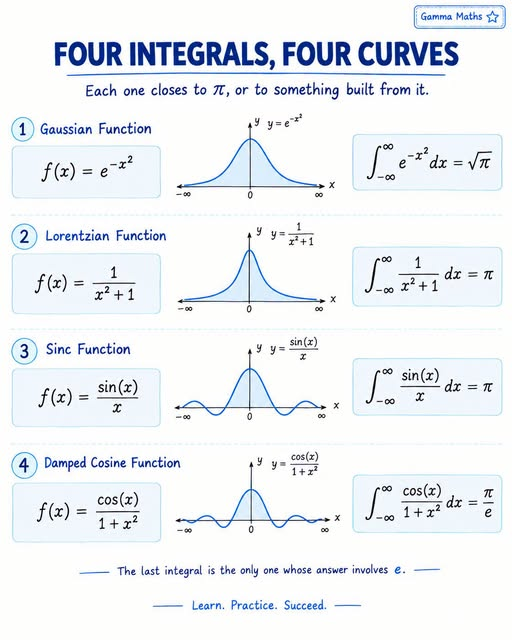

<style>
@import url("https://nyteowldave.neocities.com/style.css");
@import url("https://nyteowldave.github.io/std/style/ghost.css");
</style>

<style>
* { box-sizing : border-box; }
</style>

<style>
#surface {
	width      : 800px;
	height     : 600px;
	background : black;
	color      : mintcream;
	border     : 1px dashed gold;
}
</style>

<style>
#footer_input {
	width : calc( 100vw - 160px ) !important;
}
</style>

<!-- ~~~~~~~~~~~~~~~~~~~~~~~~~~~~~~~~~~~~~~~~~~~~~~~~~~~~~~~ -->

[me-tower]:
<http://dave-tower/demo/latex/area/integral-curves.html>
"Tower Edition"

[me-omega]:
<http://dave-omega/demo/latex/area/integral-curves.html>
"Omega Edition"

<!-- ~~~~~~~~~~~~~~~~~~~~~~~~~~~~~~~~~~~~~~~~~~~~~~~~~~~~~~~ -->

<h1 id="_T_"> Integral Curves </h1>

----------------------------------------------------------------

> [Tower][me-tower]
> [Omega][me-omega]

> [Area Menu](./../area-menu.html)
> [Math Peaches](./../../web/peaches/math/)

> [File System](./)

----------------------------------------------------------------

<h1> Gaussian </h1>

----------------------------------------------------------------

$$
\int_{-\infty}^{+\infty} { e^{-{x^2}} } dx = \sqrt{\pi}
$$

----------------------------------------------------------------

<h3> JavaScript </h3>

```
f =(x)=> 1 / exp( x*x );
```

----------------------------------------------------------------

<h1> Lorentzian </h1>

----------------------------------------------------------------

$$
\int_{-\infty}^{+\infty} { \frac {1} { x^2 + 1 } } dx = \pi
$$

----------------------------------------------------------------

<h3> JavaScript </h3>

```
f =(x)=> 1 / ( x * x + 1 );
```

----------------------------------------------------------------

<h1> Sine </h1>

----------------------------------------------------------------

$$
\int_{-\infty}^{+\infty} { \frac { \sin { (x) } } { x } } dx = \pi
$$

----------------------------------------------------------------

<h3> JavaScript </h3>

```
f =(x)=> sin( x ) / x;
```

----------------------------------------------------------------

<h1> Damped Cosine </h1>

----------------------------------------------------------------

$$
\int_{-\infty}^{+\infty}
{ \frac { \cos { (x) } } { 1 + {x^2} } }
dx = \frac { \pi } { e }
$$

----------------------------------------------------------------

<h3> JavaScript </h3>

```
f =(x)=> cos( x ) / ( 1 * x * x );
```

----------------------------------------------------------------

# Diagram

<div center>
	
</div>

----------------------------------------------------------------

# Plot

<div center>
	<canvas id="surface"></canvas>
</div>

----------------------------------------------------------------

| Var   | Value     | Type    | Description       |
|-------|-----------|---------|-------------------|
| fn    | <input /> | String  | Callback Function |
| lo    | <input /> | Real    | Lower X Bound     |
| hi    | <input /> | Real    | Upper X Bound     |
| steps | <input /> | Natural | Number of Samples |
| ox    | <input /> | Real    | Origin X          |
| oy    | <input /> | Real    | Origin Y          |
| sx    | <input /> | Real    | Scale X           |
| sy    | <input /> | Real    | Scale Y           |

----------------------------------------------------------------

<div center>
  <button id="btn-accept">Accept</button>
  <button id="btn-cancel">Cancel</button>
  <button id="btn-reset">Reset</button>
</div>

----------------------------------------------------------------

<header id="messages"></header>
<footer id="footer">
 <input id="footer_input" wide onchange="perform(event)" />
</footer>

----------------------------------------------------------------

<script>
; iwm = Object.keys( window ).sort()
</script>

<script>
; doc = ( document )
; doc . title = ( _T_.textContent ).trim()
</script>

<script>
; gid =( i )=> ( doc.getElementById( i ) )
</script>

<!-- ~~~~~~~~~~~~~~~~~~~~~~~~~~~~~~~~~~~~~~~~~~~~~~~~~~~~~~~ -->

<script src="https://nyteowldave.github.io/std/api/gems/prolog-beta.js"></script>
<script src="https://nyteowldave.github.io/std/api/gems/interpreter-lite.js"></script>
<script src="https://nyteowldave.github.io/std/api/install.js"></script>

<!-- ~~~~~~~~~~~~~~~~~~~~~~~~~~~~~~~~~~~~~~~~~~~~~~~~~~~~~~~ -->

<script src="https://nyteowldave.github.io/chachi/api/math.js"></script>
<script src="https://nyteowldave.github.io/chachi/api/mathplus.js"></script>

<!-- ~~~~~~~~~~~~~~~~~~~~~~~~~~~~~~~~~~~~~~~~~~~~~~~~~~~~~~~ -->

<script src="https://nyteowldave.github.io/std/api/bluto/message-ops.js"></script>

<!-- ~~~~~~~~~~~~~~~~~~~~~~~~~~~~~~~~~~~~~~~~~~~~~~~~~~~~~~~ -->

<script src="https://nyteowldave.github.io/std/api/bluto/gems/acquire.js"></script>
<script src="https://nyteowldave.github.io/std/api/bluto/gems/docify.js"></script>
<script src="https://nyteowldave.github.io/std/api/bluto/gems/suggestions.js"></script>

<!-- ~~~~~~~~~~~~~~~~~~~~~~~~~~~~~~~~~~~~~~~~~~~~~~~~~~~~~~~ -->

<script>
const btn_accept = gid( "btn-accept" );
const btn_cancel = gid( "btn-cancel" );
const btn_reset  = gid( "btn-reset"  );
</script>

<!-- ~~~~~~~~~~~~~~~~~~~~~~~~~~~~~~~~~~~~~~~~~~~~~~~~~~~~~~~ -->

<script>
;
; _fn = []
; _fn[ 0 ] =(x)=> ( 1 / exp( x * x  ) )
; _fn[ 1 ] =(x)=> ( 1 / ( x * x + 1 ) )
; _fn[ 2 ] =(x)=> ( sin( x ) / x )
; _fn[ 3 ] =(x)=> ( cos( x ) / ( 1 * x * x ) )
;
</script>

<!-- ~~~~~~~~~~~~~~~~~~~~~~~~~~~~~~~~~~~~~~~~~~~~~~~~~~~~~~~ -->

<script>
function main( event ) {
	try {
		btn_accept . onclick = do_accept;
		btn_cancel . onclick = do_cancel;
		btn_reset  . onclick = do_reset;
		plot . xctr   = 0;
		plot . yctr   = 400;
		plot . xscale = 1.0;
		plot . yscale = Math.floor( plot . yctr * 0.95 );
		form . reset();
		blurt( "Ready for Action!" );
	} catch ( e ) {
		bummer ( e );
	}
};

addEventListener( "load", main );
</script>

<!-- ~~~~~~~~~~~~~~~~~~~~~~~~~~~~~~~~~~~~~~~~~~~~~~~~~~~~~~~ -->

<script>
function plot( fn, lo, hi, steps ) {
	try {
		_plot( fn, lo, hi, steps );
	} catch ( e ) {
		bummer( e );
	}
}
</script>

<!-- ~~~~~~~~~~~~~~~~~~~~~~~~~~~~~~~~~~~~~~~~~~~~~~~~~~~~~~~ -->

<script>
;
; plot . xctr   = 0
; plot . yctr   = 400
; plot . xscale = 1.0
; plot . yscale = 1.0
;
; plot . examples = _fn
;
; srf = ( null )
; gfx = ( null )
;
</script>

<!-- ~~~~~~~~~~~~~~~~~~~~~~~~~~~~~~~~~~~~~~~~~~~~~~~~~~~~~~~ -->

<script>
function _plot( fn, lo, hi, steps ) {
	const gfx = plot . graphics();

	fn = ( fn || _fn[ 0 ] );
	lo = ( lo || 0   );
	hi = ( hi || 800 );
	const gap = ( hi - lo );

	steps     = ( steps || ( gap / 3 ) );
	const dx  = ( gap / steps );

	plot . clear( gfx );

	gfx . lineWidth   = dx * 0.9;
	gfx . strokeStyle = "mintcream";
	for ( let x = lo; x < hi; x += dx ) {
		let y = fn( x );
		plot.vline( x, y, gfx );
	};
}
</script>

<!-- ~~~~~~~~~~~~~~~~~~~~~~~~~~~~~~~~~~~~~~~~~~~~~~~~~~~~~~~ -->

<script>
plot.graphics = function() {
	if ( null === srf ) {
		srf = gid( "surface" );
		srf . width  = 800;
		srf . height = 600;
	}
	gfx = srf . getContext( "2d" );
	gfx . strokeStyle = ( gfx . strokeStyle || "mintcream" );
	return ( gfx );
};
</script>

<!-- ~~~~~~~~~~~~~~~~~~~~~~~~~~~~~~~~~~~~~~~~~~~~~~~~~~~~~~~ -->

<script>
plot.clear = function( gfx ) {
	const srf = gfx.canvas;
	const w = srf . width;
	const h = srf . height;
	gfx . clearRect( 0, 0, w, h );
	return ( gfx );
}
</script>

<!-- ~~~~~~~~~~~~~~~~~~~~~~~~~~~~~~~~~~~~~~~~~~~~~~~~~~~~~~~ -->

<script>
plot.vline = function( x, y, gfx ) {
	const kx = plot . xscale;
	const ky = plot . yscale;
	const xo = plot . xctr;
	const yo = plot . yctr;
	y *= ky;
	x = xo + x * kx;
	console.debug( { x, y } );
	gfx = ( gfx || plot.graphics() );
	gfx . beginPath();
	gfx . moveTo( x, yo     );
	gfx . lineTo( x, yo - y );
	gfx . stroke();
};
</script>

<!-- ~~~~~~~~~~~~~~~~~~~~~~~~~~~~~~~~~~~~~~~~~~~~~~~~~~~~~~~ -->

<script>
plot.example = function( index ) {
	const i  = parseInt( index );
	const fn = _fn[ i ];
	if (! fn ) {
		alert( "Example Index is Out of Bounds" );
		return;
	}
	plot( fn );
};
</script>

<!-- ~~~~~~~~~~~~~~~~~~~~~~~~~~~~~~~~~~~~~~~~~~~~~~~~~~~~~~~ -->

<script>
form = function() {
	const id = "frm-params";
	let te = gid( id );
	if ( te ) { return ( te ); }
	te = ( all( "TABLE" )[ 0 ] );
	te . id = ( id );
	return ( te );
}
</script>

<!-- ~~~~~~~~~~~~~~~~~~~~~~~~~~~~~~~~~~~~~~~~~~~~~~~~~~~~~~~ -->

<script>
form . values = {
  fn    : "( x )"
, lo    : 0
, hi    : 800
, steps : 800
, ox    : plot.xctr
, oy    : plot.yctr
, sx    : plot.xscale
, sy    : plot.yscale
};
</script>

<!-- ~~~~~~~~~~~~~~~~~~~~~~~~~~~~~~~~~~~~~~~~~~~~~~~~~~~~~~~ -->

<script>
form.rows = function() {
	const te = form();
	const be = te.tBodies[ 0 ];
	return arr( be . rows );
};
form.input = function( re ) {
	const ce = re.cells[ 1 ];
	return ce . querySelector( "INPUT" );
};
form.varname = function( re ) {
	const ce = re.cells[ 0 ];
	return str( ce . textContent );
};
</script>

<!-- ~~~~~~~~~~~~~~~~~~~~~~~~~~~~~~~~~~~~~~~~~~~~~~~~~~~~~~~ -->

<script>

form . clear = function() {
	const ops = form;
	const o = {};
    o . fn    = "(0)";
	o . lo    = 0;
	o . hi    = 0;
	o . steps = 0;
	o . ox    = 0;
	o . oy    = 0;
	o . sx    = 0;
	o . sy    = 0;
	ops . write( o );
};

form . reset = function() {
	const ops = form;
	return ops . write( ops . values );
};

form . write = function( o ) {
	const ops = form;
	const wr =( re )=> {
		const k = form . varname( re );
		const v = ( o[ k ] );
		switch( k ) {
		case "fn" :
			ops . write . value( re , v );
			return;
		case "steps" :
			ops . write . int( re , v );
			return;
		default :
			ops . write . real( re , v );
			return;
		}
	};
	const m = ops . rows();
	m . forEach( wr );
	return ( ops );
};

form . read = function() {
	const ops = form;
	const o = {};
	const rd =( re )=> {
		const k = form . varname( re );
		let v;
		switch( k ) {
		case "fn" :
			v = ops . read . value( re );
			break;
		case "steps" :
			v = ops . read . int( re );
			break;
		default :
			v = ops . read . real( re );
			break;
		}
		o[ k ] = v;
	};
	const m = ops . rows();
	m . forEach( rd );
	return ( ops );
};

form . write . value = function( re, value ) {
	const ops = form;
	const ie = ops . input( re );
	ie . value = str( value );
	return ( ie );
};

form . write . int = function( re, value ) {
	const ops = form;
	const ie = ops . input( re );
	const n = parseInt( str( value ) || 0 );
	ie . value = ( n );
	return ( ie );
};

form . write . real = function( re, value ) {
	const ops = form;
	const ie = ops . input( re );
	const n = parseFloat( str( value ) || 0 );
	ie . value = ( n ? n : "0.0" );
	return ( ie );
};

form . read . value = function( re ) {
	const ops = form;
	const ie = ops . input( re );
	return ( str( ie . value ) );
};

form . read . int = function( re ) {
	const ops = form;
	const ie = ops . input( re );
	const n = parseInt( str( ie . value ) || 0 );
	return ( n );
};

form . read . real = function( re ) {
	const ops = form;
	const ie = ops . input( re );
	const n = parseFloat( str( ie . value ) || 0 );
	return ( n );
};

</script>

<!-- ~~~~~~~~~~~~~~~~~~~~~~~~~~~~~~~~~~~~~~~~~~~~~~~~~~~~~~~ -->

<script>
function do_incomplete( s ) {
	dangit( `Incomplete : ${s}` );
};
function do_accept( event ) {
	try {
		do_incomplete( "do_accept()" )
	} catch ( e ) {
		bummer( e );
	}
};
function do_cancel( event ) {
	try {
		do_incomplete( "do_clear()" )
	} catch ( e ) {
		bummer( e );
	}
};
function do_reset( event ) {
	try {
		do_incomplete( "do_reset()" )
	} catch ( e ) {
		bummer( e );
	}
};
</script>
